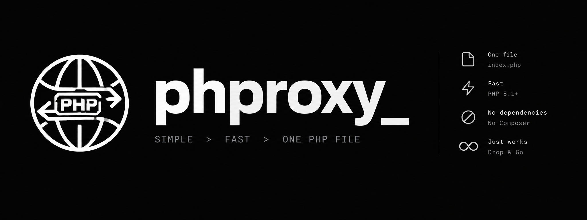

# PHProxy

A self-contained PHP web proxy with a browser interface and JSON fetch API.
It fetches public HTTP/HTTPS pages, rewrites links and assets, and keeps upstream
cookies and request settings in a server-side session. No Composer or database.



## Install with Docker

```sh
docker run -d --name phproxy --restart unless-stopped \
  -p 127.0.0.1:8080:80 \
  miglen/phproxy:latest
```

Open **http://localhost:8080/**. Images target Linux AMD64 and ARM64.
Use a numbered release tag instead of `latest` when you want a fixed version.
For port **80**, use `-p 127.0.0.1:80:80` instead, then open http://localhost/.
The same image works on either port; no rebuild is needed.

### Docker Compose

```sh
git clone https://github.com/PHProxy/phproxy.git
cd phproxy
docker compose up -d
```

Compose defaults to port **8080**. To use port **80**:

```sh
PHPROXY_PORT=80 docker compose up -d
```

To keep that port for later commands, add `PHPROXY_PORT=80` to a local `.env` file.

The production configuration uses the published image, a read-only filesystem,
temporary session storage, and a localhost port. Update with
`docker compose pull && docker compose up -d`.

## Deploy behind HTTPS

Keep the localhost binding and put an HTTPS reverse proxy with authentication
in front. PHProxy has **no built-in authentication**. For example, set
`PHPROXY_PUBLIC_URL=https://proxy.example/index.php` before running Compose.
This must be the full public script URL; use your renamed filename if applicable.

Only public HTTP/HTTPS destinations are supported. Upstream pages are sandboxed
with scripts blocked by default, preserving stylesheet and font access.
Enabling scripts uses a separate, opaque origin; session-bound stylesheets and
fonts may then fail. Open **Settings** in the browsing bar to change options without
leaving the current page. JavaScript-heavy sites,
sign-in flows, CAPTCHAs and WebSockets may not work.
This is a page proxy, not a VPN or a guarantee of anonymity.
Upstream cookies are scoped to the exact target host; cross-subdomain sessions
may need separate sign-ins.

Session state includes upstream cookies, custom headers and encrypted-URL keys.
The supplied Compose setup clears that state when its temporary storage is lost
on container stop/recreation. Previously encrypted links may then stop working.
Optional port/certificate diagnostics are disabled by default; enable them with
`PHPROXY_DIAGNOSTICS=1` only for a private, authenticated deployment.

## JSON API

```sh
curl 'http://localhost:8080/index.php?api=fetch' \
  -H 'Content-Type: application/json' \
  -d '{"url":"https://example.com/"}'
```

The response includes the upstream status, headers and body. Public-destination
validation and certificate verification also apply to API requests.

## Develop locally

```sh
docker compose -f docker-compose.yml -f compose.dev.yml up --build -d
```

The development override builds locally and mounts only `index.php`, read-only.
The same `PHPROXY_PORT=80` prefix selects port 80 for this command too.
Run checks with a PHP CLI: `php tests/transport.php`, `php tests/browser.php`,
`php tests/ui.php`, `php tests/cli.php`, and `php tests/panel.php`.
CI tests PHP 8.1/8.5 and both image architectures.

For a standalone host, copy `index.php` into your web root. PHP 8.1+ is compatible;
use a maintained version with OpenSSL, mbstring and zlib enabled, and outbound
stream sockets allowed. No database, cURL extension or Composer install is needed.

## Project

- [Release and Docker Hub instructions](docs/releasing.md)
- [Docker Hub overview](docs/dockerhub.md)
- [Report an issue](https://github.com/PHProxy/phproxy/issues)
- [GNU GPL v3 license](LICENSE.md)

Originally developed by A.A. (whitefyre), 2002–2007; maintained by the contributors
listed in the source and Git history.
